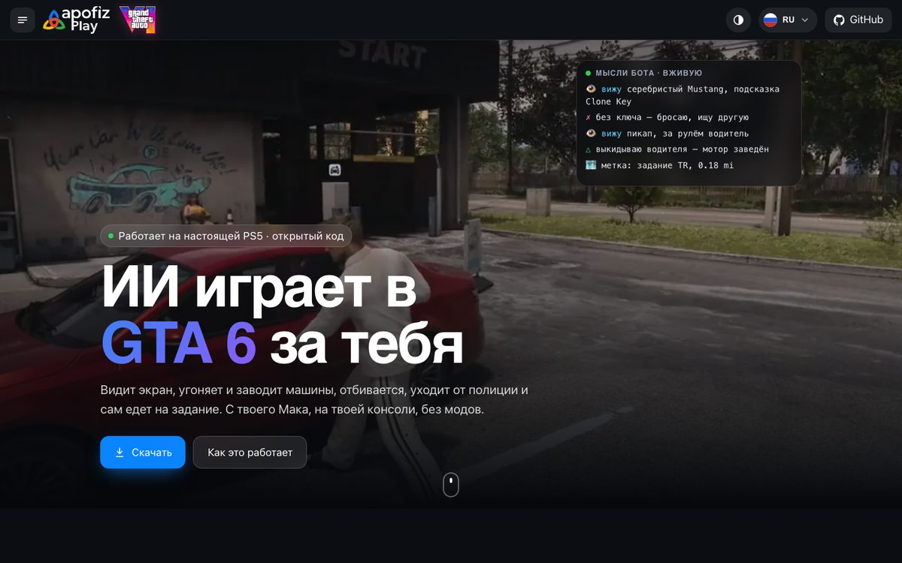
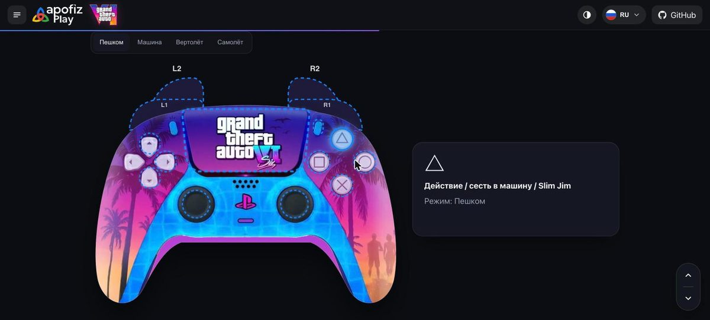
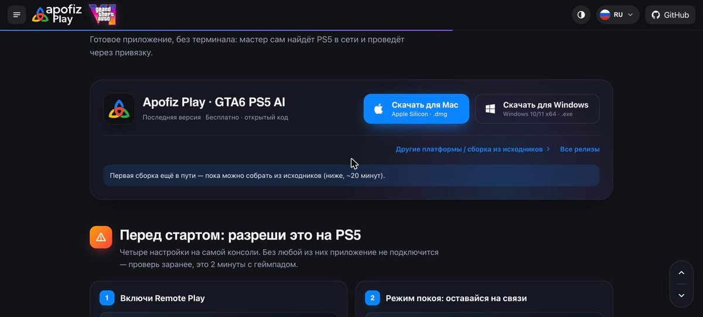
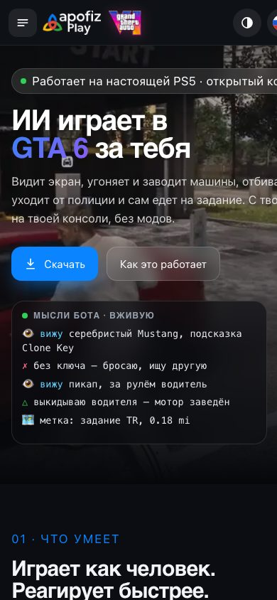

<p align="center">
  <a href="https://apofiz.com">
    <picture>
      <source media="(prefers-color-scheme: dark)" srcset="assets/apofiz-logo-white.png">
      
    </picture>
  </a>
</p>

<h1 align="center">GTA6 PS5 AI by Apofiz</h1>

<p align="center">
  <b>An AI agent that plays Grand Theft Auto VI on a real PS5 — from your Mac or Windows PC.</b><br>
  It sees the screen, steals cars, hotwires them, fights back, escapes the police and drives to missions on its own.<br>
  Built by <a href="https://apofiz.com">Apofiz</a>.
</p>

---

## Website & preview

**Live site:** https://blobus01.github.io/GTA6-PS5-AI-by-Apofiz/ · **Single-file HTML** (works offline): [`site/GTA6-PS5-AI-by-Apofiz.html`](site/GTA6-PS5-AI-by-Apofiz.html)

<p align="center"><a href="https://blobus01.github.io/GTA6-PS5-AI-by-Apofiz/"></a></p>

<table>
  <tr>
    <td width="50%"></td>
    <td width="50%"></td>
  </tr>
  <tr>
    <td align="center"><sub>Interactive gamepad — every control the bot knows (RU/EN)</sub></td>
    <td align="center"><sub>Download for Mac &amp; Windows, PS5 permissions checklist</sub></td>
  </tr>
</table>

<p align="center"><br><sub>Mobile, dark/light, auto language</sub></p>

## What it does

- **Plays on a real console.** Connects to your PS5 over Sony Remote Play (chiaki-ng), reads the video stream and presses gamepad buttons — no mods, no PC version.
- **Brain.** Claude (via the Claude Code CLI and *your own* subscription) looks at a frame every ~2–3 s and decides: find a car, break in, fight, flee, drive.
- **Reflexes (no LLM, ~1 ms).** Reads health, wanted stars, WASTED and damage tint straight from HUD pixels; YOLO11 finds cars and people at 15 Hz (Apple Silicon GPU on Mac, NVIDIA GPU or CPU on Windows). Being shot → it shoots back immediately.
- **Car theft like a human.** WAiNK scanner first, skips keyless (Clone Key) and tracked cars, carjacks drivers, Slim Jim (△ + right-stick circles), smashes windows (□), hotwires with the L/R semicircle mini-game.
- **Drives to missions.** Sets a waypoint on the map (pink story icons), then uses the in-game Quick Navigation autopilot; falls back to its own driving if stuck.
- **Knows the controls.** A compact cheat-sheet for the bot plus a full knowledge base (on foot, combat, every vehicle type, police, phone, missions) in [`knowledge/`](knowledge/).
- **Streamer-ready.** OBS overlay with the bot's live "thoughts" at `http://127.0.0.1:8765/overlay`.

## How it works

```
PS5 ──Remote Play──► server.py (chiaki-ng bridge, 127.0.0.1:8765)
                        │  frames                      ▲ buttons / sticks
                        ▼                              │
                 pilot.py  ← hud.py (health, stars)  ──┘   15 Hz reflexes + YOLO11
                        ▲
                 agent.py  ← brain.py (Claude, event-driven)   goals: car → drive → mission
```

| File | Role |
|---|---|
| `server.py`, `ps5native.py`, `native/` | Remote Play bridge (video in, controller out), web remote, REST API |
| `pilot.py` | Fast loop: YOLO, compass, steering, fight/flee reflexes |
| `hud.py` | Pixel HUD reader: health, wanted stars, WASTED, map/black screens |
| `brain.py` | Persistent Claude process, short JSON answers, token logging |
| `agent.py` | Goals and scenarios: steal a car, autopilot to the waypoint, recover after death |
| `controls_gta6.md`, `knowledge/` | Controls cheat-sheet and full knowledge base |
| `mcp_server.py` | MCP tools so any agent (Claude Code etc.) can drive the PS5 |

## Download

| Platform | Download |
|---|---|
| macOS, Apple Silicon (M1 and newer) | [**ApofizPlay-GTA6-mac-arm64.dmg**](https://github.com/blobus01/GTA6-PS5-AI-by-Apofiz/releases/latest/download/ApofizPlay-GTA6-mac-arm64.dmg) |
| Windows 10/11 x64 | [**ApofizPlay-GTA6-win-x64-Setup.exe**](https://github.com/blobus01/GTA6-PS5-AI-by-Apofiz/releases/latest/download/ApofizPlay-GTA6-win-x64-Setup.exe) |
| Anything else | [All releases](https://github.com/blobus01/GTA6-PS5-AI-by-Apofiz/releases/latest) or [build from source](#build-from-source) |

Open the app and the setup wizard finds your PS5 on the network, signs you in to PSN and links the console. Then pick a goal and the bot plays.

### Before you start: allow these on your PS5

Miss any one of these and the app can't connect:

1. **Enable Remote Play:** Settings → System → Remote Play → *Enable Remote Play*.
2. **Rest mode:** Settings → System → Power Saving → Features Available in Rest Mode → turn on *Stay Connected to the Internet* and *Enable Turning On PS5 from Network*.
3. **Same PSN user:** the PS5 must have the same PSN account you sign in with in the app, and that user must be allowed Remote Play (family/child accounts: in parental controls). Otherwise you get error `0x80108b12`.
4. **Link Device:** Settings → System → Remote Play → *Link Device* shows an 8-digit code; type it into the app's wizard. One time only; keys stay on your computer.

### Build from source

<details>
<summary>macOS, Apple Silicon — five steps, about 20 minutes</summary>

1. **PS5:** Settings → System → Remote Play → enable. Same home network as the Mac/PC (cable recommended — Wi-Fi drops frames).
2. **Install:**
   ```bash
   git clone https://github.com/blobus01/GTA6-PS5-AI-by-Apofiz.git && cd GTA6-PS5-AI-by-Apofiz
   python3 -m venv .venv && .venv/bin/pip install -r requirements.txt ultralytics
   .venv/bin/python tools/build_native.py      # builds native/libps5bridge.dylib (see docs/07-building.md)
   ```
3. **Configure:** copy `.env.schema` → `.env.local`, set `PS5_HOST` to your console's IP.
4. **Run the server:** `./start.sh`, open `http://127.0.0.1:8765`, sign in to PSN and link the console with the 8-digit code (one time; keys stay in `~/.ps5-remote/`).
5. **Install Claude Code** and log in with your subscription (`claude`), then start GTA VI and run:
   ```bash
   .venv/bin/python agent.py car 10     # find & steal a car, then drive to the waypoint, for 10 minutes
   ```

</details>

## Status

Early and experimental. Works: console control, map waypoints, car approach, Slim Jim, carjacking, hotwire, HUD reflexes. In progress: reliable combat, police evasion, full mission play, auto-clipping highlights (chases, shootouts) for Shorts.

## Credits & license

- Remote Play web remote and MCP server are based on [ps5-agent-remote](https://github.com/Jeff-Kazzee/ps5-agent-remote) by Jeff Kazzee (MIT). Original README: [`docs/ps5-agent-remote-README.md`](docs/ps5-agent-remote-README.md).
- Third-party components and their licenses (chiaki-ng AGPL-3.0, Ultralytics AGPL-3.0, …): [`THIRD_PARTY.md`](THIRD_PARTY.md).
- MIT License — see [`LICENSE`](LICENSE).

> Grand Theft Auto VI is a trademark of Rockstar Games / Take-Two Interactive. PlayStation and PS5 are trademarks of Sony Interactive Entertainment. This project is not affiliated with or endorsed by them. Use it only with your own console and your own copy of the game.

<p align="center"><a href="https://apofiz.com"></a><br><sub>Made with ❤️ by <a href="https://apofiz.com">Apofiz</a></sub></p>
